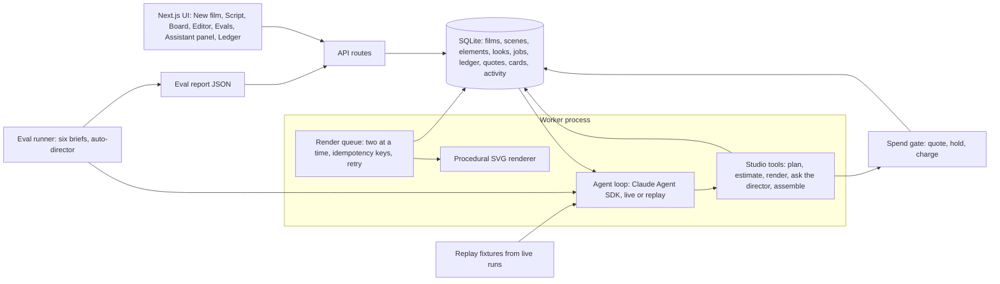

# Greenlight

A film assistant you hand a brief and a credit budget: it plans the scenes through tool calls, prices every simulated render against the budget, stops for your approvals and assembles the cut.


Full video: https://github.com/ArchiusVuong-sudo/greenlight-film-agent/releases/download/v0.1/demo.mp4

## What it does

- You type a brief, a target length, an aspect ratio, a clip resolution and a credit budget, then hand the film to the assistant. It writes the title, the look, 3-5 scenes and the cast, location and prop elements, and the board fills in as it goes.
- Every edit to the plan runs screenwriting checks in code: total length within 10% of the target, `INT./EXT. PLACE - TIME` headings, action the camera can see, dialogue that fits the shot, and every speaker and element defined.
- It asks before it spends. It estimates the whole plan first; when the plan does not fit, it stops with a budget card and lets you pick (for example clips at 720p). A render over the budget is refused and turned into a single-use quote that only you can approve.
- Looks are yours. References render in a background queue (a library match is reused for 0 credits), then the assistant stops at a look card: approve each look or send one back with a note such as "yellow raincoat, not red", and take 2 comes back yellow.
- Frames and clips render two at a time. A simulated provider timeout retries on the same idempotency key and is charged once. The editor puts the clips in scene order, lets you trim, re-runs export checks on every change and plays a 9:16 animatic.
- The Activity view logs every model turn, tool call and render job with time, credits, tokens and errors. The ledger shows grants, holds, charges and cost per usable shot, counting rejected takes. The Evals tab shows the latest scored run of six synthetic briefs.

## Architecture



## How it works

**Two processes, one SQLite file.** The Next.js app only reads and writes SQLite (WAL mode with a busy timeout). The worker (`src/worker`) runs the assistant and the render queue. Director answers land in SQLite and the worker sends them to the assistant. `npm start` starts both.

**The assistant.** `src/agent/live.ts` runs the Claude Agent SDK on the local Claude Code login (or `ANTHROPIC_API_KEY`). The query is locked down: no built-in tools (`tools: []`), only the 13 studio tools from an in-process MCP server listed in `allowedTools`, `permissionMode: "dontAsk"` so nothing else can be approved, no settings files, strict MCP config, no saved session, a fresh temp `cwd`, a turn limit and a child environment built from an allowlist. Each director stop ends a model turn; the answer goes into the same live session as the next message, through a streaming prompt.

**Tools with guards in code.** Every tool (`src/agent/tools.ts`) validates its input with zod, logs one Activity row and returns JSON. The rules the model must not break live in the tool layer, not in the prompt:
- `estimateCost` prices a request from the synthetic catalog and rounds the total up once.
- `renderReferences`, `renderFrames` and `renderClips` go through the spend gate (`src/lib/studio.ts`): inside the budget they queue jobs and place holds; outside it they refuse and create a single-use quote that expires in 10 minutes. Approving the quote queues exactly the quoted jobs.
- Frames are refused until every linked element has an approved or reused look. There is no tool that approves looks.
- Idempotency keys come from the target and its inputs (`ref:mara:v2`, `frame:s3:...`), so a repeated call returns the existing job and adds no hold.
- If the model ends its turn right after a refusal without asking, the server opens the budget or look card itself.
- Pause makes the next tool call return `paused`, so the turn ends cleanly; Continue or a typed instruction resumes it.

**Render queue.** `src/worker/queue.ts` runs jobs stored in SQLite two at a time with live progress. A hold becomes a charge of the same amount on success and is released after the third failed attempt. Renders are procedural SVG (`src/lib/render/svg.ts`) in the film's palette, using the approved look colours, and every image is stamped "Simulated render". A clip is its frame plus a camera move.

**Live and replay.** One provider interface has two implementations. Live is the SDK. Replay (`src/agent/replay.ts`) plays model turns recorded from real live runs (`fixtures/`), and their tool calls run through the same tool layer, so guards, holds, jobs and the trace are real. The app uses live when it finds a login or key and replay when `DEMO_REPLAY=1` or none is found, and then shows a "Replay mode" badge. Cards in replay mark the choice the recorded run made. A failed sign-in before any tool call switches the run to replay; overloaded, rate-limit and 5xx errors retry with backoff in a fresh session that gets the current state, which the idempotent tools make safe.

**Evals.** `npm run eval` runs six synthetic briefs through the live assistant with an auto-director (approve looks, pick the budget option that fits best, never approve spend over the budget). It scores the five plan checks plus four trace checks: an estimate comes before the first render, askDirector comes right after a refusal, no frame is requested before look approval, and the run ends with a cut or an open card (the 20-credit brief must end on a budget card). It writes `evals/report.json` with its date, model and tokens, and the Evals tab shows it.

**Trade-offs.** Polling every 700 ms keeps the UI simple and is enough for one director; a production version would push events. Sessions are not saved to disk, so a worker restart ends the run and Continue starts a fresh session from a state summary. Replay follows the recorded path, so choosing a different option in replay does not change what the recorded assistant does next.

## Run it

Needs Node 22 or later. Live mode needs a Claude Code login on this machine or `ANTHROPIC_API_KEY`; replay mode needs neither.

```bash
npm ci
npm run build
npm start                    # web on http://127.0.0.1:4105 plus the worker
DEMO_REPLAY=1 npm start      # replay the recorded runs, no login or key
npm test                     # unit and end-to-end tests, replay mode, no network
LIVE=1 npm run test:live     # opt-in live smoke test
npm run eval                 # score the six briefs live, writes evals/report.json
npm run record               # re-record fixtures/tea-flask.json from a live run
npm run reset                # delete the local database
```

Environment variables (see `.env.example`; `npm start` reads `.env`):

| Variable | Default | Meaning |
| --- | --- | --- |
| `PORT` | `4105` | Port for the web app (bound to 127.0.0.1) |
| `AGENT_MODEL` | Claude Code default | Model for the assistant, for example `claude-sonnet-5-5` |
| `DEMO_REPLAY` | `0` | `1` plays the recorded runs instead of calling the model |
| `ANTHROPIC_API_KEY` | unset | Optional; without it the local Claude Code login is used |
| `GREENLIGHT_DB` | `data/greenlight.db` | SQLite file shared by the web app and the worker |
| `RENDER_LATENCY_SCALE` | `1` | Multiplies the simulated 1-3 s render time |

## Tests

`npm test` runs Vitest in replay mode with no network:
- Pricing: per-line prices, rounding the request once, holds that add up to the quote.
- Plan and export checks: each rule, the hyphen and dash headings, the 10% and 1 s limits, "fixed" status.
- Spend gate: holds inside the budget, refusal and single-use quotes outside it, expired quotes, idempotency keys, the look guard and the frame order.
- Render queue: the two-at-a-time limit, charges, the simulated timeout charged once, released holds, redo colours in frames.
- Tools and runner: input validation, pause, refusals, server-opened cards, director answers into the same session, retry with backoff, the switch to replay on a failed sign-in.
- End to end: the full main flow from a recorded live run (budget card, redo, retry, cut, trim, trace checks) and each recorded eval brief.

## Notes

- All data is synthetic: the briefs, people, brands, model catalog and credit prices are invented, and every render is a procedural SVG labelled "Simulated render". No real image or video model is called.
- Token counts and the dollar figure come from the SDK result; the dollar figure is an estimate, not a bill.
- A production version would add real generation providers behind the same queue and ledger interface, with webhooks instead of a simulated timeout.
- It would also add accounts and per-team budgets, events pushed to the browser instead of polling, and saved sessions so a run survives a worker restart.
- Evals would grow into a larger brief set with blinded human ratings of the cuts next to the code-scored checks.
